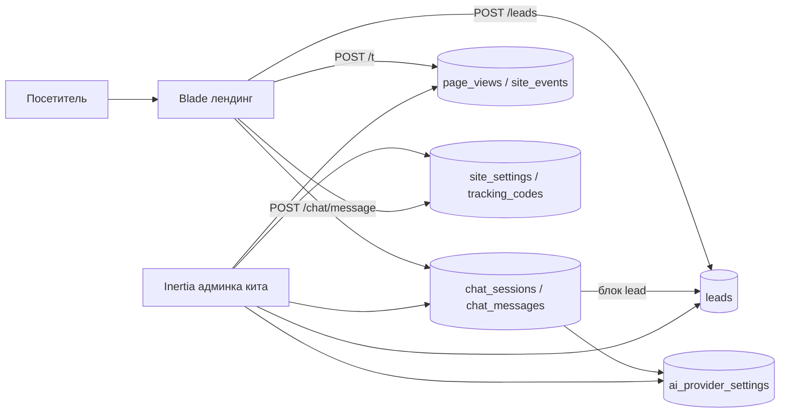

# 01. Архитектура

Одно Laravel-приложение. Публичный лендинг — Blade и vanilla JS. Админка — React/JSX через Inertia и Vite (кит v0.5.0). Общие: БД, `.env`, пользователи кита, `ai_provider_settings`.

Лендинг — Blade и vanilla JS, отдельные входные точки Vite `resources/css/landing.css` и `resources/js/landing.js`. В этот бандл не входят React и Inertia. Админка — React/JSX через Inertia. Пиксели и маячок стоят на `/` и `/privacy`. Админка их не выводит.

## Публичные роуты

| Метод | Путь | Назначение |
| --- | --- | --- |
| GET | `/` | Лендинг |
| GET | `/privacy` | Текст политики на английском. Ссылка в футере лендинга и под формой. Баннера согласия нет |
| POST | `/leads` | Заявка с формы |
| POST | `/chat/message` | Сообщение ассистенту |
| POST | `/t` | Маячок аналитики (`sendBeacon`) |

`POST /leads` и `POST /chat/message` проходят CSRF, валидацию и throttle. На форме дополнительно honeypot. `POST /t` без CSRF: `sendBeacon` шлёт JSON как `text/plain`. Тело больше 4 КБ отбрасывается. Ответ всегда 204, в том числе на отказ и на throttle. Запись принимается, только если host `Origin` (или `Referer`, если `Origin` нет) совпадает с host `APP_URL`.

Throttle по IP: `/leads` — 5 запросов в минуту, `/chat/message` — 20 запросов в минуту, `/t` — 60 запросов в минуту. Числа чата лежат в `config/nadia.php`: 20 запросов в минуту с IP, 30 сообщений пользователя на сессию, 100 сообщений пользователя в сутки на `ip_hash`, 1500 сообщений пользователя в сутки на весь сайт (`nadia.chat.daily_global_limit`), сообщение до 1000 символов, в контекст — последние 20 сообщений, ответ до 500 output tokens.

## Роуты админки

Фронт — `resources/js`, страницы `resources/js/Pages/**/*.jsx`, каркас `AdminLayout.jsx`. Меню слева, подписи en/ru/uk:

1. Dashboard — `dashboard`, `GET /dashboard`. KPI за последние 30 календарных суток Чикаго: заявки без spam, уникальные посетители, конверсия (заявки / посетители), сессии чата. Под ними график визитов по дням и пять последних заявок.
2. Leads — `leads.index` `GET /leads`, `leads.show` `GET /leads/{lead}`, `leads.update` `PATCH /leads/{lead}`, `leads.destroy` `DELETE /leads/{lead}`, `leads.export` `GET /leads/export.csv`. В меню бейдж `status=new`. Публичная запись — `leads.store` `POST /leads` (throttle `leads`, 5/мин по IP), вне auth.
3. Chats — `chats.index` `GET /chats`, `chats.show` `GET /chats/{session}`, `chats.destroy` `DELETE /chats/{session}`. Список по 25, фильтр «только с заявкой» и период как у заявок.
4. Statistics (группа): Analytics — `analytics.index`, `GET /analytics`. Периоды Today / 7d / 30d (по умолчанию) / 90d / Custom. Logs — `statistics.logs`, `GET /statistics/logs`.
5. Pixels & codes — `tracking.index` `GET /tracking-codes`, `tracking.store`, `tracking.update`, `tracking.destroy`, `tracking.pixels`. Quick setup для Pixel/GA4 и свои сниппеты.
6. Settings — `settings.index`, `GET /settings`. Вкладки: General, Users, AI, Assistant (`?tab=assistant`), Telegram, Notifications (`?tab=notifications`). Assistant сохраняется через `settings.assistant.update` и `settings.assistant.reset`. Уведомления — `settings.notifications.update`. Вкладка Telegram по-прежнему подключает бота.

Рядом остаются Auth, Profile (`profile.edit`), `GET /ai-settings` (редирект кита на вкладку AI), `GET /owl-admin/health`, `POST /telegram/webhook`. `GET /app-settings` (`app-settings.index`) оставлен только потому, что smoke кита ищет это имя: редирект на `/settings` без вкладки App. Вкладки App в настройках нет.

CRM-модули Customers, Orders, Services, Staff, Calendar из приложения убраны. Их URL больше не зарегистрированы.

## Как чат берёт провайдера

1. Лендинг показывает кнопку чата только если в `site_settings` чат включён (`chat_enabled`, по умолчанию да) и в `ai_provider_settings` есть строка с `is_active` и `is_connected`. Решение принимается на сервере при рендере `GET /`. Виджет — отдельные `resources/js/chat-widget.js` и `resources/css/chat-widget.css`, без React.
2. `POST /chat/message` берёт активную запись `AiProviderSetting`. Ключ читается через cast `encrypted` кита и в логи не пишется. У кита есть только `listModels`: генерации ответа в `AiProviderManager` нет, поэтому запрос делает `App\Ai\ChatClient`. OpenAI — Chat Completions с `max_completion_tokens`; у reasoning-моделей (`gpt-5*`, `o1*`, `o3*`, `o4*`) ещё `reasoning_effort` (`minimal` / `low`), лимит не меньше 2000 и без `temperature`. Anthropic — Messages API с заголовком `anthropic-version`, текст собирается из всех блоков `type=text`. Gemini — `generateContent`; у 2.5/3.x `thinkingBudget` 0 для flash и 512 для pro, `maxOutputTokens` 2000. Таймаут 30 секунд, один повтор через 1 секунду на 429 и 5xx. Пустой текст ответа — ошибка `empty response` и запасной ответ.
3. В запрос уходят system prompt из `site_settings.assistant_system_prompt` и последние 20 сообщений сессии. Первая строка промпта `[DRAFT — replace with client-approved prompt]` в модель не отправляется. Ответ ограничен 500 output tokens. Если провайдер отвечает ошибкой, посетитель получает запасной текст, а в `chat_messages.error` пишется короткая причина без ключа.
4. Сессия создаётся на первом сообщении. В неё пишутся `visitor_id` из cookie `nadia_vid`, `ip_hash`, user agent и атрибуция из cookie `nadia_ft` (source, medium, campaign, referrer, landing path). `nadia_vid`, `nadia_ft` и `nadia_sid` не шифруются: их ставит JS лендинга. На сессию — не больше 30 сообщений пользователя. Сверх лимита — 429. Суточные потолки: 100 на `ip_hash` и 1500 на сайт.
5. Блоки `<lead>{json}</lead>` и незакрытый хвост `<lead` вырезаются до сохранения и до ответа. JSON: `name`, `email`, `phone`, `goal`, `summary`. Заявка создаётся при непустом `name` и непустом `email` или `phone`, `source=chat`, `message` = summary, ссылки в обе стороны. Повторный блок той же сессии дописывает только пустые поля и не шлёт `LeadCreated`. Невалидный блок игнорируется, в лог пишется warning без персональных данных. Неизвестный `goal` сохраняется как `consult`.

Приветствие (`assistant_greeting`) показывается в виджете первым сообщением. В API и в базу оно не уходит.

Провайдеры активной строки кита: OpenAI, Anthropic, Gemini.

## Заявки

Форма: обязательны name, email, goal. Phone и message необязательны. Goal — одно из `sell`, `buy`, `invest`, `consult`.

К заявке с формы и из чата пишутся UTM (`utm_source`, `utm_medium`, `utm_campaign`, `utm_term`, `utm_content`), referrer, landing path, visitor_id, ip_hash, user_agent. У формы `source=form`. У чата `source=chat` и `chat_session_id`.

Статусы: `new`, `in_progress`, `done`, `spam`. Заметку пишет админ. CSV выгружает текущую выборку с теми же фильтрами, что таблица: статус, источник, период.

Успешный ответ формы, если заданы ID, даёт фронту сигнал вызвать `fbq('track','Lead')` и gtag `generate_lead`. Вызов только в браузере на лендинге.

## Аналитика

Маячок стоит только на лендинге.

- Cookie `nadia_vid`: first-party, 1 год, `SameSite=Lax`, `Secure`, без `HttpOnly`. Это не сессия Laravel.
- Cookie `nadia_sid`: UUID, `Max-Age` 1800, продлевается на каждом просмотре и событии. 30 минут без активности — новая сессия. В БД поле называется `session_id`.
- `resources/js/tracker.js` — отдельный entry без зависимостей. На загрузке шлёт pageview: `path` = `location.pathname`, UTM из query, referrer только если хост внешний. Слушает `nadia:lead` (`form_submit`), `nadia:chat_open`, `nadia:chat_lead`. Не шлёт, если `navigator.webdriver === true`.
- Сервер сам разбирает User-Agent (`App\Support\UserAgent`): device, browser, os. `referrer_host` считается из referrer; хост приложения сохраняется как null.
- В `page_views` нет `ip_hash` и нет сырого IP. `ip_hash` остаётся у заявок и сессий чата.
- Пустой User-Agent, UA из `nadia.tracking.bot_pattern` и залогиненный админ не пишутся.
- События `form_submit`, `chat_open`, `chat_lead` пишутся в `site_events`.
- `analytics:prune` каждый день в 04:00 UTC удаляет `page_views` и `site_events` старше 12 месяцев.
- Группировка по дням — календарные сутки `America/Chicago`. Границы суток считает PHP и подставляет в SQL. `CONVERT_TZ` не используется: таблицы таймзон MySQL пустые. Кэш отчёта — 5 минут, ключ включает период.

Админские HTML-ответы маячок не содержат.

## Время

`APP_TIMEZONE=UTC`. Показ дат в админке и границы суток в аналитике берутся из `config('app.display_timezone')`, значение `America/Chicago`.

## Пиксели

`tracking_codes` и ID из `site_settings` (`meta_pixel_id`, `ga4_measurement_id`) выводятся на `/` и `/privacy` через `App\Support\TrackingCodes`: head, начало body, конец body, в порядке `sort`. Сниппет вставляется как есть. Залогиненному админу пиксели, сниппеты и `tracker.js` не отдаются. Layout админки их не содержит. `nadia:lead` и `nadia:chat_lead` вызывают `fbq('track','Lead')` и `gtag('event','generate_lead')`, если эти функции уже есть на странице.

Новая заявка (`LeadCreated`, не spam и не повторный блок в чате) уходит в Telegram и на почту после ответа клиенту, если канал включён на вкладке Notifications. Ошибка одного канала не останавливает второй.

## Появление Laravel в этом репозитории

На шаге 2 в каталоге уже лежат `.git`, `docs/`, `reference/`, `reports/`, `README.md`. `composer create-project` в этот каталог не запускается.

Порядок:

1. `composer create-project laravel/laravel` во временный каталог, constraint Laravel 13.
2. Скопировать проект в `/var/www/nadia` без `--delete` и без замены `.git`.
3. Не затирать `README.md`, `docs/`, `reference/`, `reports/`.
4. Файл `.env` из временного проекта не коммитить. В git попадает только `.env.example`, после правок под MySQL этого сайта.

Дальше установка кита — строго по `reference/admin-kit-install.md`.
